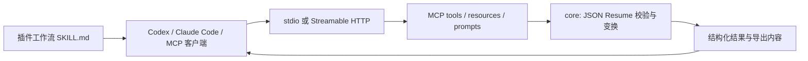

# 架构

## 范围

核心聚焦“其他智能体可以安装并调用”的插件。宿主智能体理解请求、读取用户提供的文件、完成措辞调整；插件提供确定性的校验、变换、模板预览和导出。附带工作台只提供本地可视化操作，复用同一核心。

## 模块边界

- `core/resume.ts` 使用固定版本 `@jsonresume/schema` 与 Ajv 校验；完整性提醒不等于事实核验。内容 revision 是规范化 JSON 的 SHA-256。
- `core/patch.ts` 在副本上原子应用 JSON Patch 子集，并再次校验结果。`expectedRevision` 只核对输入副本，不提供跨请求数据库锁、持久历史或账户版本管理。
- `core/match.ts` 将调用方提供的关键词定位到原文字段。西文按词边界匹配，中日韩文本使用字面子串。结果附带 JSON Pointer 和原文，不生成录用预测。
- `core/export.ts` 导出完整 JSON 和保留自定义字段的 Markdown 大纲。
- `core/documents/` 提供 PDF / DOCX 文本提取、30 种精选模板、文件渲染器和隔离工作线程。`render-pdf.ts` 的分页计划同时生成嵌入字体的 PDF 和内联字形的 SVG 预览；Word 独立生成可编辑段落与表格。提取原文交给宿主整理事实。
- `studio/page.ts` 是无需外部资源的工作台；`transports/studio.ts` 只绑定 loopback，提供模板、示例和按请求预览/导出，调用相同工作线程。校验 Host、Origin、自定义请求头及请求体大小；无账户、数据库、服务端文件读写或网页遥测。
- `file-cli.ts` 提供宿主本地文件桥接，只读写指定路径，避免 base64 进入模型上下文；与无文件路径权限的 MCP 工具分开。
- `mcp/server.ts` 统一注册工具与结构化结果，注明副作用、输入限制和能力边界。所有工具当前均不写外部状态，所以 `readOnlyHint=true`。
- `transports/http.ts` 每个请求建立独立 MCP server/transport，不共享用户文档；限制 Host、Origin、请求体大小和并发。此实现没有账户或 OAuth，适合无账户、无持久状态的工具服务；以后增加私有存储前必须新增隔离和认证。

## 分发

一个 MCP 主程序、一个文档工作线程 bundle 和固定的中文字体，同时用于 npm 和插件包。字体与第三方声明随包携带，安装及运行不下载字体或执行编译脚本。

- 通用 MCP：npm 包暴露 `super-resume-mcp` 可执行命令；Registry 只登记发现元数据。
- Codex / 支持 Agent Plugins 的客户端：根 `plugin.json` + `mcp.json` + `skills/`。
- Claude Code：`.claude-plugin/plugin.json` + `.mcp.json` 适配宿主占位符。
- 根目录两份 marketplace 清单均指向 `plugins/super-resume`，不读取参考仓库。

HTTP 作为额外接入入口保留，当前 Registry 发布目标是 npm/stdio。若未来要进入远程应用目录，应单独完成公开 HTTPS 服务、隐私与支持页面、发布者验证、部署运行验证等平台流程。

## 数据处理

MCP 服务不进行外部请求，不写用户简历，不记录请求内容。JSON Resume 上限 256 KiB、嵌套上限 20 层；文件上限 5 MiB、PDF 上限 30 页；HTTP 请求上限 8 MiB。导出通过 MCP 返回，宿主决定保存位置。运行在别人的 HTTP 服务上时，简历会发送给该服务；默认本地 stdio 没有这一步。

每次文档操作启动独立工作线程，最多并发 2 个、30 秒超时、V8 old generation 上限 256 MiB；这不是操作系统级内存沙箱。线程输出不进入 MCP stdout 或请求日志。DOCX ZIP 逐项读取并限制实际流大小，拒绝重复成员、加密项、DTD 和超限展开，只在内存读取选中的文本 XML。

## 精选版式（0.7.1）

`core/documents/templates.ts` 是 117 套版式的统一清单，`designs.ts`、`design-collection.ts` 和 `folded-styles.json` 定义版式的页头、分栏、栏目样式与照片位置组合；MCP、CLI 和工作台使用相同目录。PDF 和 SVG 共用分页计划，HTML 打包全部 SVG 页；Word 独立生成可编辑段落与表格。照片仅接受尺寸及大小受限的嵌入 PNG/JPEG，不请求外部网址。工作台缩略图由真实 PDF 预览生成，串行排队并缓存，避免与内容预览争抢工作线程。旧社区库和采集材料迁入被 Git 忽略的 `references/retired/theme-library-0.4.1/`，不进入新插件包。
